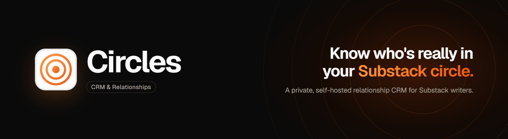
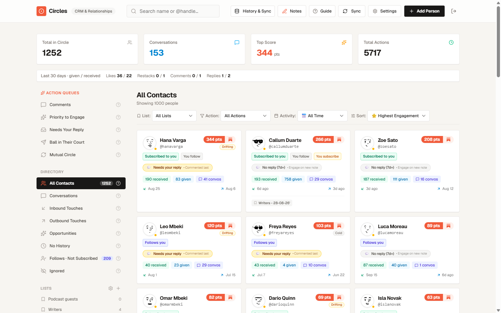
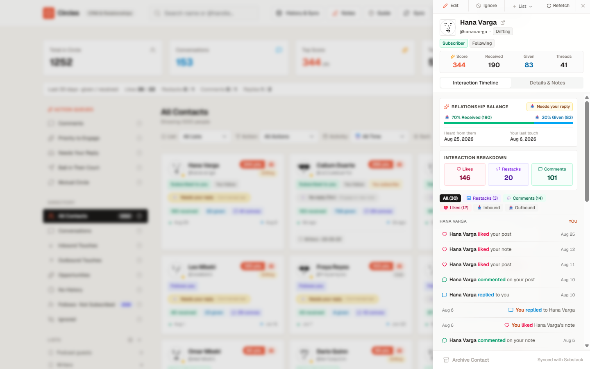
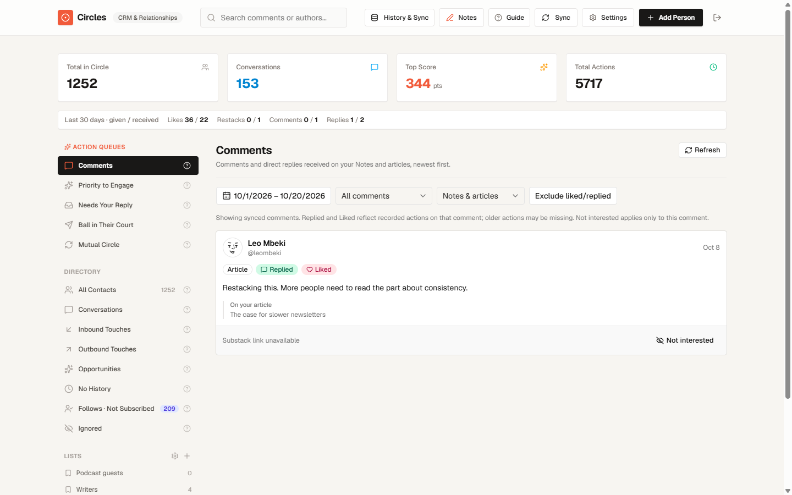
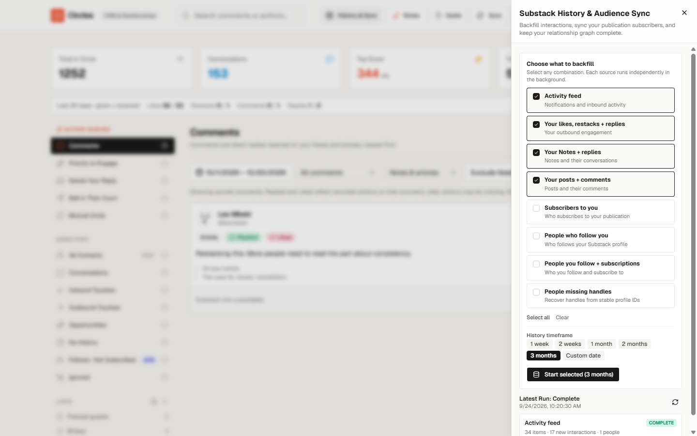
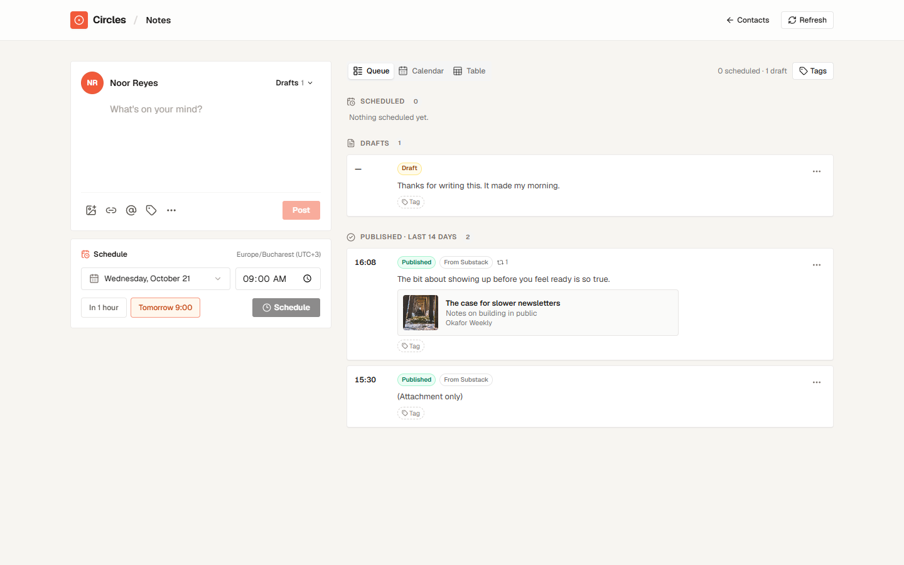

# Circles CRM

A private, self-hosted relationship CRM for Substack writers. Circles turns your
Substack activity — Likes, restacks, comments, replies, follows and
subscriptions, on your Notes and posts and on other people's — into contacts,
interaction timelines and relationship scores, so you can see who engages with
you, who you engage with, and who is waiting on a reply. Built by
[Chillital](https://chillital.com).

> **Unofficial.** Circles is not affiliated with or endorsed by Substack. It
> reads Substack through an unofficial API client using **your own browser
> session cookie**, which it stores on your server (encrypted when
> `SESSION_TOKEN_KEY` is set). Automated access may conflict with Substack's
> terms and could affect your account; use it at your own risk, for your own
> account only.

https://github.com/user-attachments/assets/672cb069-f317-4a2c-836b-433ece799f46

## Features

Screenshots show generated sample data.

### Contacts, scores and queues

Everyone who engages with you, or whom you engage with, becomes a contact,
merged by stable Substack profile ID. Inbound and outbound engagement are scored
separately, so what you receive never inflates what you give, and the strip
under the totals shows given / received per action. Queues surface people who
need a reply, drifting relationships and priority contacts; lists and tags
organize the rest.



### Contact timelines

Each contact has a full interaction timeline in both directions, with the Note
or post it happened on, a relationship balance and a per-action breakdown.



### Comment triage

Comments and direct replies on your Notes and articles, newest first, marked
when you have already replied or liked, and filterable by date, status and
content type.



### Background sync and history backfills

A PostgreSQL job queue polls the notification feed, refreshes reply trees on
your recent Notes and posts, reconciles subscribers and who you follow, and
records new followers from follow notifications.
Resumable backfills import older history per source, with honest progress for
streams Substack only partly exposes.



### Note scheduling

Write, schedule and tag Substack Notes. Drafts live in Substack and Substack
itself publishes them at the scheduled time, so nothing depends on Circles
being up.



### Companion Chrome extension

Connects your Substack session and captures your outbound likes, restacks and
replies as they happen. See [Browser extension](#browser-extension).

### MCP server

An OAuth-protected `/api/mcp` endpoint that lets AI agents read and manage your
CRM with scoped grants (see [docs/mcp.md](docs/mcp.md)).

### Multi-tenant safety

PostgreSQL row-level security on every tenant table, a restricted runtime
database role, and append-only migrations.

## Architecture

A Bun + Turborepo monorepo:

| Path | What |
|---|---|
| `apps/web` | Astro SSR + React UI (shadcn-style components from `packages/ui`) |
| `apps/api` | Hono API, Better Auth, MCP/OAuth server, SQL migrations |
| `apps/worker` | PostgreSQL-backed job runner: sync, imports, enrichment, replay |
| `packages/core` | Substack client adapter and the canonical ingestion/scoring logic |
| `packages/ui` | Shared UI primitives |
| `extension` | Chrome Manifest V3 companion extension |

Production runs as a Docker Compose app (`compose.yaml`): a one-shot `migrate`
service, then `api`, `worker` and `web`, next to a PostgreSQL database. Raw
Substack responses are retained as evidence so parser fixes can be replayed
without refetching. [AGENTS.md](AGENTS.md) is the detailed technical briefing;
`plans/` holds design notes.

## Self-hosting

Requirements: Docker, PostgreSQL (developed on 18) and a reverse proxy or tunnel that serves
one public HTTPS hostname.

1. Copy `.env.example` to `.env` and fill it in. `DATABASE_URL` is an admin
   connection used only by the `migrate` service, which creates the restricted
   `circles_migrate` and `circles_app` roles with the passwords you choose.
   Generate secrets with `openssl rand -base64 32`.
2. The compose file joins an external Docker network named `dokploy-network`
   (it was built for [Dokploy](https://dokploy.com)). Elsewhere, create it with
   `docker network create dokploy-network` and attach your PostgreSQL and proxy
   containers to it.
3. Route `/api/*` and `/.well-known/*` to `api:3000` and everything else to
   `web:4321`. [docs/operations.md](docs/operations.md) has a Cloudflare Tunnel
   example.
4. `docker compose up -d --build`. Migrations run automatically on every start.
5. Create your account with `ALLOW_SIGNUP=true` for the first sign-up (then set
   it back to `false`), or run
   `docker compose run --rm api bun apps/api/dist/create-user.js you@example.com 'password'`.
6. In Settings → Connection, paste your `substack.sid` cookie or connect through
   the extension.

## Browser extension

Install [Circles Companion from the Chrome Web Store](https://chromewebstore.google.com/detail/circles-companion/bkflpfcomkiclmnllggooedkfcbmflnn),
click its toolbar icon, enter your Circles address as the **Circles server**
and allow access when Chrome asks. The extension only gets access to that one
site; it registers its app bridge there at runtime.

Each version is also attached to the repository's
[Releases](https://github.com/cucoleadan/circles-app/releases). To build it
yourself:

```sh
cd extension
bun run pack
```

This writes `extension/circles-companion-<version>.zip`: unzip it, open
`chrome://extensions`, enable Developer mode, choose **Load unpacked**, then
pair your server from the popup. Set `EXTENSION_STORE_URL` if Settings should
link to your own store listing.

## Local development

```sh
bun install
cp .env.example .env   # point DATABASE_URL at a local Postgres
bun run dev            # API :3000, worker, web :4321
```

`bun run dev` uses `DATABASE_URL` directly. To develop against a remote
database over SSH instead, set `CIRCLES_SSH_HOST` and `CIRCLES_SSH_DB_ENV_FILE`
(see `scripts/dev.ts`).

```sh
bun run typecheck
bun run test           # needs DATABASE_URL (admin) + APP_DB_PASSWORD/MIGRATE_DB_PASSWORD; creates circles_test
```

## License

[MIT](LICENSE). Made by [Chillital](https://chillital.com).
