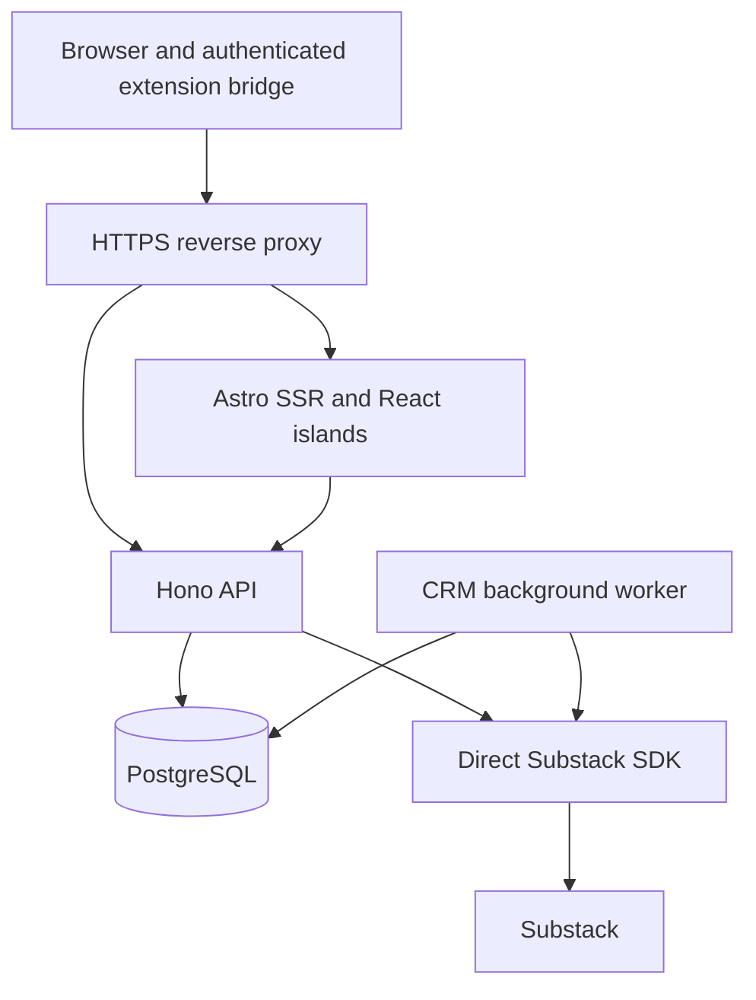

# Circles and CRM: VPS rebuild plan

Status: proposed implementation plan, based on source review on 2026-09-16.

**Recommendation: an Astro SSR web service, a Hono API, and a background worker deployed as a Docker Compose application in Dokploy, plus a separate Dokploy PostgreSQL service.** Use Better Auth and the Substack SDK directly in the backend.

The scope is exclusively Circles and CRM. This supersedes the full-app scope discussed initially. Existing data outside this scope must be backed up, not deleted.

## 1. Scope and working assumptions

Build:

- Circles overview, contact profiles and conversation timelines.
- Contact creation/editing, private CRM notes, relationship status, lists, tags and pinned views.
- Inbound/outbound interaction history, last engagement, last conversation and opportunity discovery.
- Substack account connection, profile enrichment, incremental activity sync and historical imports.
- Companion extension connection, add-to-CRM/list workflows and passive activity/conversation capture.
- Authentication, tenant isolation, migration, backups and VPS operations supporting these features.

Exclude from this release: publication analytics/dashboard, personal content feed, note library/composer, note scheduling, publishing, image uploads, and AI summaries. Displaying a post/note title, excerpt or conversation as CRM context remains in scope. Posting comments/replies, likes or restacks from StackedHQ is deferred; capture and display those actions when performed on Substack. The user has not specifically requested outbound publishing features within the CRM rebuild.

Assume the current multi-user model and one active Substack connection per user. Replace Clerk with **self-hosted Better Auth**, backed by the same PostgreSQL service as the application. Start with email/password authentication and closed registration: provision or migrate the authorized users, then set `disableSignUp: true`. Password reset and email verification require a transactional-email provider; if that is not configured for the first private release, document an administrator-run recovery procedure before cutover. No organizations, billing, or multi-publication interface in this release.

“D2” is interpreted as Cloudflare D1, which is the database actually configured in this repository.

## 2. What the source review found

Existing source filenames below retain their legacy names so references match the current codebase. The rebuilt feature and API use Circles.

Reviewed route/configuration and migration inventory, the Circles/CRM repositories and UI, ingestion/enrichment/backfill code, extension bridge/capture code, gateway contracts and tests. Also inspected the sibling `stackedhq-gateway` and `substack-edge-sdk` checkouts read-only. Production data, VPS capacity, deployed versions, and runtime behavior were not inspected or benchmarked. Historical project documents contain stale status; source code is the primary evidence.

| Area | Current implementation | Rebuild consequence |
|---|---|---|
| Circles | `app/routes/app.orbit.tsx`, `orbit-overview.tsx`, `orbit-profile-drawer.tsx` | Preserve overview/drawer/timeline workflows, remove React Router dependencies. |
| CRM | `community.repository.server.ts`, `community-directory.tsx`, `community-dialogs.tsx`, `community/actions.server.ts` | Extract contact/list/tag services from mixed content and engagement actions. |
| Overview queries | `orbit.repository.server.ts` aggregates all saved interactions; `orbit-data.ts` filters loaded people in the browser | Add database filtering, bounded results and cursor pagination. Current “Show more” is not database pagination. |
| Person history | Route loads 100–1,000 interactions, then groups them in `conversation-timeline.ts` | Add stable pagination and thread-aware loading; avoid silently presenting partial threads as complete. |
| Activity ingestion | `relationship-ingestion.server.ts` handles notifications and captured replies | Preserve idempotency, grouped senders, direction and richer-content merging. |
| Sync dependency | `dashboard/analytics-sync.server.ts` performs CRM ingestion alongside email analytics | Extract dedicated CRM jobs; removing the dashboard must not remove ingestion. Move shared classifiers from `dashboard/activity.ts` into the domain package. |
| Historical import | `activity-backfill-controls.tsx` repeatedly submits `backfillStep` while Circles is open | Move execution to the worker; keep start/pause/resume/progress UI. |
| Extension | Cookie connection, authenticated app-tab bridge, contact creation, persisted capture queue | Keep the extension as a supported data source; direct SDK access does not replace everything it observes. |
| Upstream backend | Sibling gateway already uses Hono and `unofficial-substack-sdk`; local SDK is 0.3.14 | Reuse validation, decryption and client-factory concepts. Replace gateway HTTP hops with backend module calls. Verify the exact installed/published release before pinning. |
| Storage/cache | D1 data, Workers Cache API responses, Durable Object coordination | Replace with PostgreSQL repositories, snapshots and job leases. |
| R2 | Source references use the bucket for extension ZIP/version artifacts | Ship those artifacts with the release; an object-storage service is unnecessary for this scope. |
| Scheduled refresh | Wrangler config has only `*/15 * * * *`; Worker checks `0 * * * *` for full community refresh | Define explicit CRM schedules. The existing full-refresh branch cannot be selected by the configured cron. |

`plans/fixes.md` is an existing untracked user file and remains unchanged. Its CRM requests are included below. They are recorded requirements, not proof that each reported bug has been reproduced.

## 3. Database decision

Use **PostgreSQL as a separate Dokploy database service/container**, on the same VPS as the application initially. Give it its own persistent volume, lifecycle, health check, credentials and backup policy. Never install PostgreSQL inside the `api`, `web`, or `worker` image. The services share a private Docker network and reach PostgreSQL by its internal hostname; PostgreSQL has no public domain or host-published port.

Use the `pg` driver, a small connection pool per API/worker process, parameterized SQL in typed repositories, and versioned SQL migrations. An ORM is optional later; the existing code is already SQL-oriented. Astro accesses Hono, not the database. Better Auth and the CRM can use the same PostgreSQL server and database while keeping Better Auth's tables and application tables clearly separated by naming or PostgreSQL schemas and migration ownership.

| Option | Fit for this app | Decision |
|---|---|---|
| PostgreSQL | Relational CRM, concurrent ingestion and user edits, transactions, JSON metadata and worker coordination | Recommended. |
| SQLite in WAL mode | Excellent operational simplicity for a small single-process application; one writer at a time | Valid for a tiny personal app, but API plus worker writes make PostgreSQL a better default. |
| A full self-hosted backend platform | Adds services beyond the database and API this design needs | Unnecessary for the requested simple stack. |

PostgreSQL uses MVCC to support concurrent access; SQLite documents its single-writer constraint. This is a workload-fit recommendation, not a claim that PostgreSQL wins every benchmark. [PostgreSQL concurrency](https://www.postgresql.org/docs/current/mvcc-intro.html), [SQLite deployment guidance](https://www.sqlite.org/whentouse.html).

Use one supported PostgreSQL major, pin a tested image patch/digest, and plan upgrades separately. Do not use a floating `latest` tag. Driver pooling is sufficient initially; add PgBouncer only if measured connection pressure justifies it. Transactions must use one checked-out connection, released in `finally`. [node-postgres pooling](https://node-postgres.com/features/pooling).

Speed will depend more on bounded queries and keeping Substack off the page-rendering path than on framework benchmarks. Initial targets, to validate on the actual VPS: p95 under 200 ms for stored-data API reads and under 500 ms server processing for Circles SSR, excluding internet transit. Test with an agreed realistic dataset and a larger growth dataset; these are acceptance targets, not measured results.

## 4. Deployment and application boundaries



Dokploy deployment units:

| Service | Responsibility | Exposure/storage |
|---|---|---|
| Dokploy/Traefik | HTTPS; route `/api/*`, including `/api/auth/*`, to Hono and app pages to Astro | The existing Dokploy ingress owns public ports 80/443; do not add a competing Caddy container. |
| `web` | Astro SSR and interactive React islands | Internal port; no database credentials or Substack decryption key. |
| `api` | Hono API, Better Auth, authorization, CRM operations, ingestion endpoints and sync requests | Internal port; database access, `BETTER_AUTH_SECRET`, canonical public URL and read-only mounted Substack credential keys. |
| `worker` | Activity sync, profile enrichment, conversation fetches, imports and cleanup | Same backend image, different entrypoint; no public port. |
| Dokploy PostgreSQL database | PostgreSQL for Better Auth and CRM data | Separate service/container and persistent volume; private network only; managed independently from application redeployments. |
| `migrate` | Apply schema changes once per deployment | One-shot service with a separate migration role. |
| Dokploy database backup | Encrypted logical database backup and retention | Scheduled backup to an S3-compatible destination outside the VPS, plus periodic restore tests. |

Deploy `web`, `api`, `worker`, and `migrate` as one Docker Compose application in Dokploy, while creating PostgreSQL through Dokploy's database facility. Attach the API, worker, migration job, and database to a shared private network. Do not expose PostgreSQL through Traefik. Use a normal egress-capable network for the API/worker's Substack requests; do not accidentally isolate the SDK from the internet by marking every network internal. Dokploy supports independent databases, persistent storage and scheduled S3 backups. [Dokploy databases](https://docs.dokploy.com/docs/core/databases), [Dokploy Compose networking](https://docs.dokploy.com/docs/core/docker-compose/example).

Keep the repository portable: the production Compose file receives an external `DATABASE_URL`, while a development/standalone Compose override may add a PostgreSQL container with a named volume. In either form PostgreSQL remains its own container; application images never contain database files or the PostgreSQL server.

Suggested repository layout:

```text
apps/web/                  Astro pages, layouts and React islands
apps/api/                  Hono routes and middleware
apps/worker/               CRM job runner
packages/contracts/        Validated request/response types
packages/domain/           Classification, enrichment, timeline and relationship rules
packages/db/               SQL migrations and typed repositories
packages/substack/         Direct SDK adapter, credentials and response normalization
extension/                 Companion source and tests
infra/                     Compose, proxy config and backup scripts
scripts/migration/         Export conversion, import and reconciliation
```

Choose one supported Node.js LTS version compatible with the pinned Astro adapter and SDK for all server services. Astro's Node adapter supports standalone SSR; Hono supplies a Node server adapter. The gateway currently uses Bun, so its startup/configuration must be ported if reused. [Astro Node deployment](https://docs.astro.build/en/guides/integrations-guide/node/), [Hono Node deployment](https://hono.dev/docs/getting-started/nodejs).

Use health checks and migration completion gates before starting dependent services; process start order alone is insufficient. Add runtime reconnect behavior, graceful shutdown and worker lease expiry. Build immutable multi-stage images, run application containers without root, use read-only filesystems where practical, and rotate logs. [Compose startup order](https://docs.docker.com/compose/how-tos/startup-order/).

## 5. Circles and CRM product requirements

### Circles overview

- Search contacts, handles, CRM notes, lists and tags; define conversation search separately so a preview search is not mistaken for full-history search.
- Filter by list, tag, relationship status, interaction direction/type and last-engagement range.
- Offer Conversations, Inbound, Outbound, No history and Opportunities views.
- Sort by last conversation, last engagement, interaction count or name, with stable pagination.
- Display list membership on cards, alongside tags.
- Lead with actual messages and the last conversation. Keep likes available as activity, without letting “Liked your work” dominate relationship cards.
- Distinguish **last interaction**, **last heard from them**, **last interaction from you**, and **last conversation**. A like must not update the conversation timestamp.
- Define Opportunities initially as non-archived people with captured inbound activity and no list membership. Offer an interaction-type filter; this is a deterministic view, not an AI score.

### Contact drawer and CRM management

- Edit name, handle/profile, publication, private notes, status, tags and list memberships directly in Circles.
- Keep a directory/table view for bulk browsing and list management.
- Preserve private user-entered notes when enriching profiles from Substack.
- Show inbound and outbound comments/replies on both posts and notes, including restack context when captured.
- Group conversations by typed thread identity. Show source links, timestamps, provenance and whether the saved thread is incomplete.
- Support list/tag create, rename, membership changes and delete; deleting a list must not delete its contacts or history.
- Prefer archive for contacts. Define explicit permanent deletion separately, including suppression of automatic rediscovery where requested.
- Preserve manual relationship status separately from calculated recency. Existing drift thresholds can be reused initially, but must age as time passes rather than update only when a new event arrives.

### Extension

- Fix and verify add-to-CRM/list end to end, including adding an existing contact to another list.
- Preserve the connection encryption flow and app-tab bridge; the extension marker header is not authentication.
- Persist capture batches until the backend confirms durable receipt; safely deduplicate replay.
- Reject queued data belonging to a different app user or Substack account after switching/reconnecting.
- Preserve existing `/api/ext/companion` and `/api/ext/activity` contracts initially, or ship a coordinated versioned extension update.
- Current extension POSTs also target `/app/settings`, `/app/companion`, and `/app/community`. Retain thin POST compatibility adapters during rollout, forwarding to Hono, or update all three contracts together. Page GETs still belong to Astro.
- Update production/local origin allowlists, manifest permissions, download/version files and installation instructions. Preserve the current origin if possible.

## 6. Frontend and API design

Use Astro for the authenticated shell and initial render, with one coherent React island for the interactive Circles workspace and another for the CRM directory as needed. Existing Radix/shadcn components can be adapted. React Router `Link`, loaders/actions, fetchers, revalidation and route-generated types require replacement; simply copying components will not work. Astro supports hydrating framework components as islands. [Astro framework components](https://docs.astro.build/en/guides/framework-components/).

Make filters and selected contact addressable in URL parameters. Server-render the first bounded page; load subsequent pages through the API. Explicitly refresh affected lists, counts and profile details after mutations. Preserve drawer focus, keyboard navigation, pending/error states and unsaved-edit handling.

Proposed backend surface:

| API group | Operations |
|---|---|
| `/api/v1/me` | Identity and account state |
| `/api/v1/connection` | Connect, inspect, reconnect, disconnect |
| `/api/v1/circles` | Filtered paginated cards, counts and opportunities |
| `/api/v1/people` | Contact CRUD/archive and profile detail |
| `/api/v1/people/:id/interactions` | Cursor-paginated history and thread context |
| `/api/v1/lists`, `/api/v1/tags` | CRUD, memberships and pinned views |
| `/api/v1/sync` | Enqueue refresh and return status |
| `/api/v1/imports` | Start, pause, resume and inspect historical import |
| `/api/ext/*` | Authenticated compatibility endpoints for extension ingestion |
| health endpoints | Liveness and dependency readiness; no private payloads |

Hono owns all database access, authentication and authorization. Mount Better Auth's handler on both `GET` and `POST /api/auth/*`, then resolve its session from the incoming request headers in Hono middleware. Astro and its React islands call `/api/*` through the same public origin, so the Better Auth session remains a first-party, host-only cookie and Safari does not treat it as a third-party cookie. Server-side Astro requests must forward the browser cookie to Hono; Hono remains the authority and never trusts an arbitrary `userId` header. [Better Auth with Hono](https://better-auth.com/docs/integrations/hono), [Better Auth cookies](https://better-auth.com/docs/concepts/cookies).

Configure Better Auth with an explicit production `baseURL`/`BETTER_AUTH_URL`, `basePath: "/api/auth"`, a high-entropy `BETTER_AUTH_SECRET`, PostgreSQL's `pg` pool, and an exact `trustedOrigins` allowlist for production and approved local development origins. Keep `crossSubDomainCookies` disabled because the application uses one public origin. Traefik must replace client-supplied forwarding headers with its own values; a static canonical base URL is preferred for this single-domain deployment. Only enable Better Auth's trusted-proxy-header mode if the final proxy topology requires it and direct access to Hono is blocked. Better Auth validates origins for CSRF protection and uses secure, HTTP-only cookies in production. [Better Auth options](https://better-auth.com/docs/reference/options), [Better Auth security](https://better-auth.com/docs/reference/security).

Generate Better Auth's user, session, account, and verification schema during development, review the SQL, and commit it to the application's migration history. Production deployments run reviewed, non-interactive migrations through the one-shot `migrate` service; the API must not mutate its schema at startup. [Better Auth database schema and migrations](https://better-auth.com/docs/concepts/database).

## 7. PostgreSQL data model and D1 mapping

Keep stable app/person/list/tag IDs during import. Validate whether every ID is a UUID before choosing PostgreSQL UUID columns; preserve non-UUID IDs as text if necessary. External Substack IDs should remain lossless strings at API boundaries. Use `timestamptz` for instants, `boolean` for flags and `jsonb` for validated metadata. Keep unknown timestamps/counts distinct from genuine zero values.

| Existing data | Target and handling |
|---|---|
| `users` | Create a distinct `app_users` table for CRM ownership and let Better Auth own its `user`, `session`, `account`, and `verification` tables. Preserve each existing app-owned user ID and extension-install timestamp; link one Better Auth user ID to one app user during migration. Retain the old Clerk ID temporarily as migration provenance, then remove it after the rollback window. |
| `substack_connections` | Preserve encrypted envelopes; introduce revocation/state and account generation. Reconnecting a different Substack identity must never silently relabel old history. |
| `community_people` | `people`: preserve notes, nullable `relationship_status`, handles and timestamps. Consolidate the legacy `status` duplication. Add stable Substack profile ID when known, provenance and archive state. |
| `community_tags`, `community_person_tags` | `tags`, `person_tags`, with tenant-safe membership constraints. These are CRM tags, not note-library `tags`. |
| `community_lists`, `community_list_members` | `lists`, `list_members`, preserving all membership edges. |
| `community_dashboard_views` | `saved_views` for pinned CRM lists/tags; no analytics dashboard dependency. |
| `community_interactions` | `interactions`: preserve external IDs, direction, target, thread, message text, metadata and event time. Add account/source provenance. |
| `community_engagements` | Stage as legacy outbound evidence. Merge only where identity can be proven; otherwise retain separately with provenance so potential duplicates are not silently counted twice. |
| `community_content_snapshots` | Extract profile and relevant thread/context data into `profile_snapshots`/`thread_snapshots`; archive full old payloads. Do not rebuild a content feed. |
| `activity_snapshots`, `note_replies_snapshots` | Preserve CRM-relevant capture evidence and completeness. These snapshots can contain context absent from normalized interaction rows. |
| `community_activity_backfills` | `sync_state`/`import_runs`: preserve cutoff, cursor, counts and pending page; migrate paused and clear old leases. |
| `background_sync_leases`, Durable Object state, response caches | Recreate coordination state cleanly; do not import active leases or cache generations. |
| Notes, note metrics/taxonomy, email analytics and other excluded data | Include in a full archival backup, outside the new active CRM schema. |

Add `jobs`, durable `ingestion_batches`, `relationship_stats`, and minimal audit records for sensitive account/CRM mutations. An accepted capture batch can be acknowledged after durable insertion, then processed asynchronously; old extension responses may require synchronous compatibility behavior until upgraded.

Tenant-owned tables carry `user_id`; account-specific records also identify their source account/connection generation. Use composite ownership constraints for membership edges so another user's list/tag cannot be attached even if an application check is missed. Retain one active account in the UI while preventing cross-account historical contamination.

Initial indexes should follow actual query shapes: `(user_id, normalized_handle)`, list/tag membership edges, `(user_id, person_id, occurred_at DESC, id DESC)`, typed thread lookups, unique source event keys within account scope, and due-job/lease indexes. Store rebuildable per-person totals and conversation timestamps so every overview request does not scan the full interaction archive. Use stable timestamp-plus-ID cursors. Add text-search indexes only for the search behavior chosen and measured.

SQL conversion is substantive: replace D1 `.prepare().bind().all()/first()/run()`, `.batch()` and `meta.changes`; translate `INSERT OR IGNORE/REPLACE`, `COLLATE NOCASE`, `instr`, `julianday`, `json_valid` and `json_patch`. PostgreSQL JSONB concatenation is not automatically equivalent to SQLite JSON merge patch. Preserve the enrichment precedence with explicit tests. Use atomic transactions for contact/list/tag edits and ingestion commits.

## 8. Direct SDK integration and background jobs

Extract an application-owned adapter with only the read operations this scope needs:

- Authenticated/public profiles and profile lookup.
- Activity and activity-page reads.
- Note/comment/post reads and paginated conversation replies, where needed to enrich CRM context.
- Connectivity checks.

The local SDK exposes these primitives, including `getActivityPage` and cursor-aware reply reads. Validate the pinned package against real sanitized fixtures; do not assume local checkout, public README and installed artifact are identical. Reuse normalizers from the current gateway/app boundary, but remove raw gateway envelopes from application API responses. [SDK project](https://github.com/cucoleadan/unofficial-substack-sdk).

Create a fresh SDK client for the selected account operation. Decrypt its session only inside API/worker code. Inject request deadlines and bounded retries through the transport. The SDK is unofficial, so retain schema validation and classified upstream errors. Its custom publication origin receives the session cookie: allow only verified/trusted publication origins, prevent private-network SSRF, and preserve redirect restrictions. [SDK security and request behavior](https://github.com/cucoleadan/unofficial-substack-sdk/blob/main/README.md).

The worker replaces dashboard-coupled sync and browser-driven import loops:

1. Enqueue incremental activity sync per account, initially on the existing 15-minute cadence. Manual refresh enqueues the same deduplicated work with a cooldown.
2. Refresh profiles separately, using a proposed hourly sweep with bounded per-contact freshness and on-demand refresh. Avoid fetching every contact's complete post/note feed.
3. Enrich relevant conversations in bounded pages with saved cursors and explicit completeness.
4. Import history using the existing three-month cutoff default, stopping honestly when Substack has no more data. Do not promise a complete archive.
5. Normalize extension captures and SDK reads through one ingestion path.

Claim jobs in short transactions using PostgreSQL row locking; commit before making HTTP calls. Use leases, heartbeat/expiry, retry times, bounded attempts and terminal error states. Fence every completion/checkpoint with the current lease token so an expired worker cannot overwrite a replacement worker's progress. PostgreSQL documents `SKIP LOCKED` as useful for queue-like consumers. [PostgreSQL locking](https://www.postgresql.org/docs/current/sql-select.html).

Persist received pages before processing where recovery requires it. Commit interaction upserts, affected relationship summaries and cursor advancement atomically. Duplicate delivery must not create duplicate events or increment counters twice. Keep sender-scoped grouped notifications, owner-versus-contact direction and post/note thread namespaces. Prefer stable profile IDs over handles when available; preserve ambiguous legacy identity instead of guessing.

Preserve the current monotonic enrichment rule: less detailed captures cannot erase fuller messages or better thread context. Fresh edits to upstream content need an explicit source/version policy rather than a blanket “longer always wins” rule. Classify observed third-party thread participation separately from confirmed direct interaction so conversation browsing does not falsely imply someone spoke to the account owner.

Use shared per-account rate limits across API and worker, with an additional VPS-wide ceiling. Existing request pacing values are starting behavior, not verified Substack limits. Honor rate-limit responses, retry with backoff/jitter, and pause an account on expired credentials. Pause/resume must work without an open page; use simple status polling initially.

## 9. Security, durability and performance requirements

- Verify authentication and ownership on every API read/write, export and job request. Apply CSRF/origin checks to cookie-authenticated writes, including compatibility routes. Private SSR/API responses use `Cache-Control: no-store`.
- Keep Better Auth sessions in PostgreSQL; Redis is unnecessary initially. Disable public sign-up after provisioning/migration, use generic login and recovery errors, rate-limit auth endpoints, revoke all old sessions at cutover, and test logout, expiration, password reset and account disablement through Traefik.
- Use PostgreSQL roles separated into migration, runtime and backup responsibilities. Add RLS for tenant tables with `USING` and `WITH CHECK`, tested under a non-owner, non-superuser, non-`BYPASSRLS` runtime role. Set tenant context transaction-locally on the same pooled connection; never let context persist between requests. Constrain cross-tenant job enumeration separately. [PostgreSQL row security](https://www.postgresql.org/docs/17/ddl-rowsecurity.html).
- Keep encrypted session envelopes and versioned keys. Mount keys only into services that need them; do not put them into images, git, browser props or database backups. Preserve old keys until every retained encrypted record is recoverable. Disconnect revokes credentials and stops jobs while preserving CRM history; explicit history deletion is a separate operation.
- Running the app and keys on one VPS changes the old Worker/gateway trust boundary: database-only theft is mitigated by envelope encryption, but compromise of the whole host can expose both. Host hardening and separate encrypted backups remain necessary.
- Use Compose secret files with restricted host permissions; they are a delivery mechanism, not an automatically encrypted secret vault. [Compose secrets](https://docs.docker.com/compose/how-tos/use-secrets/).
- Bound body bytes, nested conversation depth, page sizes, response sizes and queue retention. Validate external URLs and render captured text safely. Log identifiers/counts/error classes without cookies, raw captures or private CRM notes.
- Back up PostgreSQL automatically to an encrypted off-host destination and test restore into a separate database. Start with a proposed 24-hour recovery point and four-hour recovery time; require WAL archiving if the acceptable loss window is smaller. Back up credential keys separately. A Docker volume or same-host snapshot alone is not disaster recovery. [PostgreSQL backup options](https://www.postgresql.org/docs/current/backup.html).
- Monitor readiness, worker heartbeat, last successful account sync, pending-job age, import failures, disk use, connection pressure and backup age. Define alerts before production use.
- Inspect slow queries with `EXPLAIN (ANALYZE, BUFFERS)` on representative data. Bound pool sizes across all processes and leave connections for maintenance. Keep autovacuum enabled; clean expired batches and operational logs without deleting permanent relationship history.

## 10. Implementation sequence and completion gates

| Phase | Deliverables | Completion gate |
|---|---|---|
| 0. Baseline | Confirm VPS resources/ingress, account scope and Better Auth sign-in/recovery policy; inventory live schema/counts; capture sanitized fixtures; verify SDK release | Signed-off scope and reproducible examples of contact/list/timeline behavior. |
| 1. Foundation | New workspace, Astro SSR, Hono, worker image, Compose, separate Dokploy PostgreSQL, migration runner, health checks and Better Auth | Fresh setup and restart work; same-origin authenticated SSR-to-API access verified through Traefik; DB inaccessible publicly. |
| 2. Database and CRM | New schema/repositories; contacts, lists, tags, notes, statuses and archive semantics; migration converter | Tenant isolation and transactional edits pass; representative D1 import reconciles. |
| 3. Ingestion and sync | Direct SDK adapter, jobs, normalization, profile/thread snapshots, import checkpoints and summaries | Replayed captures deduplicate; interrupted imports resume; page closure does not stop work. |
| 4. Circles UI | SSR first page, React workspace, profile editing, timeline, filters, opportunities and list badges | Agreed Circles/CRM acceptance flows pass on desktop and mobile. |
| 5. Extension | Compatibility routes or coordinated version update, durable capture acknowledgments, connection/account isolation | Add contact to list, capture inbound/outbound conversation, reconnect and offline replay pass end to end. |
| 6. Cutover rehearsal | Full backup, scoped import, checksums/counts, credentials test, measured reads, backup restore, rollback rehearsal | No unexplained data discrepancies; operational recovery demonstrated. |
| 7. Release | Stop legacy CRM writers, final import, switch ingress, enable one CRM worker authority, smoke tests | Stable reads/writes and sync; retained rollback artifacts. |

The critical path is schema → ingestion correctness → real Circles data → extension compatibility → rehearsed cutover. Visual work can start earlier against agreed contracts, but should not decide storage semantics accidentally. No elapsed-time estimate is reliable until live data volume and VPS capacity are known.

## 11. Data migration and cutover runbook

1. Export a full consistent D1 backup and inventory applied migrations, row counts, IDs, timestamp formats, malformed JSON, orphaned memberships and duplicate identities. Preserve excluded product data in that backup. Export Clerk identities through Clerk's supported export/API path into protected temporary storage.
2. Build a repeatable converter/importer using explicit table mappings. A D1 SQL dump is not directly PostgreSQL-compatible. Validate JSON and timestamp conversions; quarantine invalid records with an actionable report rather than silently dropping them.
3. Create Better Auth users/accounts from the Clerk export, then link them to the preserved `app_users.id` using verified identity data. Migrate supported password hashes and social accounts only after proving sign-in in staging; require password reset or provider reauthorization for anything unsupported. Use a real CSV parser and never commit exports or password hashes. Keep Clerk available until Better Auth sign-in and rollback are verified. [Better Auth Clerk migration guide](https://better-auth.com/docs/guides/clerk-migration-guide).
4. Import application data in dependency order: app users/auth links → connections → contacts/taxonomy → memberships/views → interactions/evidence/snapshots → paused imports. Recompute derived summaries from imported evidence and compare separately with old cached counters.
5. Reconcile IDs and counts per user/table, memberships, message text, direction, thread identity, earliest/latest event times and nullable statuses. Preserve legacy outbound engagement evidence where deduplication is uncertain. Verify representative encrypted connections without logging decrypted credentials.
6. Prove replay safety by importing/capturing representative activity again. Confirm no duplicate totals and no loss of richer conversation data. Test a real backup restore.
7. During final migration, stop **all old CRM writers**: periodic ingestion, manual sync, backfill steps, profile refresh writes and extension ingestion. The extension should queue while the app is unavailable. Freeze affected contact edits. Avoid naive dual writing.
8. Export/import the final frozen state, reconcile, switch the existing app origin to the VPS, invalidate old Clerk sessions, and enable Better Auth and the new worker. Check Better Auth cookie/origin behavior through Traefik and extension version compatibility. Resume imports only for matching accounts and valid checkpoints.
9. Preserve the old deployment, Clerk configuration and D1 backup for a defined rollback window. If the new app has accepted writes, reverting DNS alone loses those changes: freeze again and reconcile/replay new CRM edits and accepted capture batches before rollback. Keep pre-release backups and deployment images available.
10. Remove Clerk dependencies and retire the old gateway/Cloudflare CRM dependencies only after the rollback window and after verifying no retained legacy feature uses them. Excluding scheduling or analytics from this release does not authorize deleting their data or shutting down an independently retained legacy workflow. Existing Substack-scheduled content is outside this migration's write scope.

## 12. Tests that determine readiness

Port the existing relevant tests instead of carrying over Cloudflare-only assumptions: `tests/community/*`, `tests/auth/user-resolution.test.ts`, applicable activity tests in `tests/dashboard/*`, and extension bridge/queue/conversation/connection tests. Run PostgreSQL integration tests against PostgreSQL, not SQLite.

Required scenarios:

- Two tenants cannot view/edit each other's people, memberships, notes, history, batches or jobs, including guessed IDs and reused pooled connections.
- Add a new/existing contact from the extension; edit notes/status/list membership in Circles; refresh and retain every change.
- Repeated grouped notifications, replies and passive captures yield stable totals; full text and parent/root context survive poorer later payloads.
- Outbound comments on notes and posts count correctly; likes affect interaction counts without changing last-conversation time; third-party thread messages are not falsely labeled direct conversations.
- A thread crossing page boundaries remains navigable and honestly marked when incomplete.
- Kill a worker before/after ingestion commit, expire a lease, replay a pending batch, disconnect/reconnect an account, and resume an import. No skipped cursor ranges, duplicate events or cross-account attribution.
- Opportunities and recency filters return the expected saved data; cards show all required membership context.
- API/SDK timeouts, expired sessions and upstream throttling leave stored Circles data readable and present actionable sync status.
- VPS restart preserves data; migration failure blocks deployment; backup restore and post-write rollback procedures are demonstrated.

This plan changes documentation only. It does not claim a production audit, performance benchmark, deployment or completed implementation.
