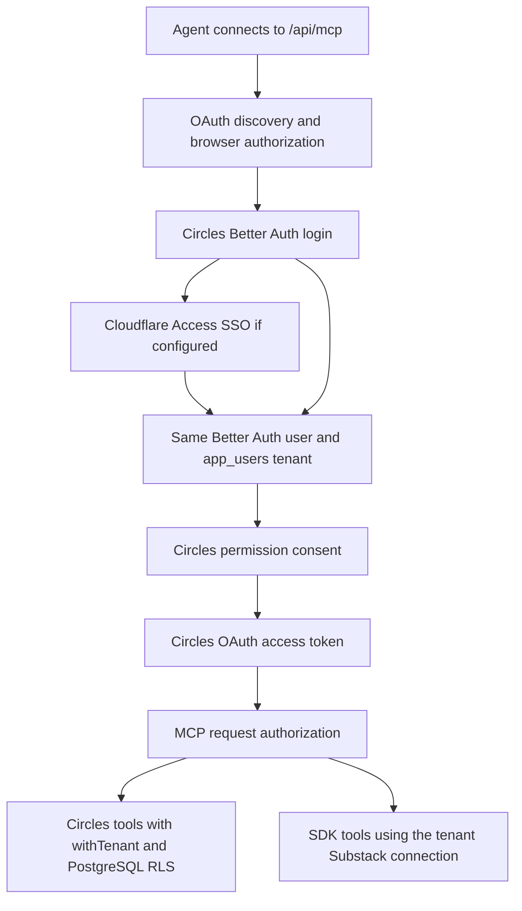

# Circles MCP implementation plan

Status: implemented in source, not deployed; see `todo.md` for verification gates
and `docs/mcp.md` for actual behavior and setup. The implementation uses the
maintained `@better-auth/mcp` OAuth wrapper with stateless legacy HTTP support.
All SDK reads are queued, rather than only expensive ones; final results retain
SDK payloads with credential redaction. Published CRM Note history retains the
app's 500-row cap, with live SDK cursor tools available for deeper extraction.
Prepared 2026-10-14 from the repository and current upstream documentation.

## Goal and decisions

Expose Circles to AI agents so they can inspect the account, prepare a daily
agenda, read scheduled Notes and drafts, find conversations needing attention,
and organize contacts and content using the same operations as the web app.
The scope also includes every tool exposed by the installed Substack SDK's
built-in MCP server. Circles MCP must be a superset of that server's capabilities.

The user clarified that the priority is **shared sign-in with Circles** and
support for **any MCP-compatible client**. Use one Better Auth identity and the
existing `app_users` tenant for both browser and agent access. Cloudflare SSO
can supply the login identity; Better Auth supplies the Circles session and
the agent's delegated permissions.

Recommended design:

- A remote MCP endpoint at `${APP_URL}/api/mcp` in the existing Hono API.
- Official MCP TypeScript SDK, HTTP transport, and request-scoped identity.
- Better Auth OAuth authorization, shared login, explicit consent, and
  revocable per-client grants.
- Cloudflare Access for SaaS OIDC as the upstream SSO login provider when
  Cloudflare SSO is desired. This feeds the same Better Auth account.
- Reuse PostgreSQL RLS, repositories, Note behavior, and the worker queue.
- Compose the SDK's existing MCP toolset with Circles tools under one endpoint
  and login; reuse its handlers, schemas, aliases, and analytics calculations.
- Deliver reads first, then organization, then publishing and other writes.

This is an API extension on the VPS. It needs no separate Worker, database,
agent runtime, or model subscription. The connected client generates the
language and decides how to use the structured data.

## What exists and what must change

`apps/api/src/auth.ts` pins Better Auth 1.6.23 with email/password login at
`/api/auth`; it has no configured SSO or OAuth provider. `/api/v1` resolves a
session to `getOrCreateAppUser(session.user.id)`. All CRM operations use
`withTenant`. The extension has its own compatibility surface.

Reusable surfaces include people and timelines, priority queues, received
comments, lists/contact tags, draft/scheduled/published Notes and separate Note
tags, queue settings, connection status, sync progress, and import controls.
Comments are available in source, but migration `032` and database/live checks
are still pending in `todo.md`; confirm them before claiming production parity.

Two query details need explicit handling:

1. `listNotes` always returns open drafts/scheduled Notes; its `from`/`to`
   arguments currently filter published history only. A day briefing must
   filter scheduled items by `triggerAt` itself. Keep the web page's existing
   semantics and add bounded MCP queries/pagination rather than silently
   changing its results. Its published-history query also caps at 500 rows;
   expose real pagination before offering complete historical extraction.
2. People queries default to large pages. MCP tools need validated filters,
   bounded pages, and explicit continuation. Reuse comment/timeline cursors
   and existing people offset semantics where suitable.

## Substack SDK MCP parity (scope added 2026-10-14)

The installed `unofficial-substack-sdk@0.4.0` already exports `createMcpServer`,
`createToolHandlers`, and `clientFromEnvironment` from its public package entry.
Its bundled CLI uses stdio. A local, network-free `tools/list` inspection
confirmed **18 capabilities registered under 36 names**: each has a snake_case
name and a camelCase alias, and all declare read-only annotations. See the
[SDK source](https://github.com/cucoleadan/unofficial-substack-sdk/blob/main/src/mcp-server.ts)
and the installed package's `dist/mcp-server.d.ts` for the version actually used.

Preserve all these capabilities:

| Area | Canonical SDK tool names |
| --- | --- |
| Account and relationships | `get_authenticated_profile`, `get_following`, `get_subscriptions` |
| Published content | `get_recent_posts`, `get_notes`, `get_profile_notes` |
| Publication performance | `get_email_stats`, `get_publication_analytics`, `get_growth_sources` |
| Post/Note analysis | `get_post_engagement`, `get_post_analytics`, `get_note_engagement`, `analyze_content` |
| Subscriber analysis | `get_subscriber_summary`, `get_subscriber_stats`, `get_paid_subscribers` |
| Notifications | `get_activity`, `get_unread_activity` |

Preserve the SDK names and aliases. Prefix added app tools with `circles_`, so
`get_notes` reads the SDK's published-profile Notes and `circles_list_notes`
reads Circles drafts/scheduled/published mirrors. Descriptions identify the data
source and freshness. Tool names in the Circles tables below are shown without
that prefix for readability. Do not replace an SDK tool with a similarly named
local query that has different semantics.

Composition requirements:

- Build the SDK client from the authenticated tenant's active Substack connection
  using `openSessionToken`; never use one process-wide account from
  `clientFromEnvironment`. Keep publication origin/session/base URL configuration
  out of tool inputs. Other-profile IDs supported by SDK read tools remain valid
  inputs; they do not change the CRM tenant or publication administrator identity.
- Use `createMcpServer(client)` as the authoritative tool registry/implementation.
  The pinned factory returns the v1 MCP SDK server, so it cannot simply be passed
  to the v2 HTTP handler proposed above. Compose it through the public v1 MCP
  Client and linked `InMemoryTransport` inside the process: discover its tool
  descriptors and forward each authenticated SDK call, then register Circles
  tools on the outer v2 server. Close request-scoped clients/transports after use.
  This preserves both remote protocol eras without copying the SDK's analytics
  code or accessing private tool registries. Prove this bridge in Phase 1.
- Reuse `createToolHandlers` for queued execution where that avoids a protocol
  bridge. Do not fork the SDK, duplicate calculations, or launch a separate
  credential-bearing stdio subprocess for each user/request.
- Preserve input validation, result schemas, defaults, aliases, read-only
  annotations, pagination and explicit raw/record opt-ins. SDK upgrades run a
  descriptor-parity check; new tools need a deliberate permission/operational
  review before exposure. Missing tools fail the parity gate.
- SDK tools read Substack live, while Circles tools read the local CRM/mirror.
  SDK reads alone do not import contacts or replace retained CRM evidence.
  Canonical ingestion remains the only path for deliberate imports/replays.
- Publication administration tools require both a publication URL and upstream
  administrator access. Preserve all tool capabilities, but return actionable
  unavailable/permission errors when the connected account cannot use one.
- Explicit SDK calls are authorized upstream reads. Coordinate their requests
  with the application's per-connection pacing, timeout, concurrency and 429
  handling; the SDK's injectable `fetch` can provide the shared request policy.
  This may require extending `createSubstackClient` to accept that fetch policy.
- Full-history publication analytics, `fetch_all` Notes, and complete reply-tree
  analytics can make many requests. Preserve the underlying capability through
  the existing durable queue when it exceeds the synchronous work budget. Return
  a documented pending run reference and expose `circles_get_tool_run`; its final
  payload is the SDK result. Declare this pending/result envelope in schemas
  rather than pretending a partial result is the SDK's completed analytics.
- Retain SDK raw-data/record options behind an additional sensitive-data grant.
  Never return cookies/session tokens or app raw snapshots. Sanitize credentials
  in upstream errors/results and keep all returned private content out of logs.

Two separately configured MCP servers can coexist in a client. The recommended
superset endpoint includes both toolsets in one connection, using the existing
Circles account connection and shared sign-in. It adds scheduled Notes, CRM
organization and daily planning to the SDK's publication/account analytics.
This scope is all SDK **MCP tools**, plus app operations; SDK class methods that
are not registered MCP tools, such as sending Likes/replies, are separate future
capabilities rather than automatically included by the parity requirement.

## Shared login and Cloudflare's role

The app and MCP share an account and browser sign-in. The agent receives its
own OAuth tokens; it does not receive the browser's session cookie. An existing
Circles login can satisfy the login step, while each client still needs a grant.

Cloudflare supports using Access for SaaS as an OIDC provider. Better Auth's
Generic OAuth integration can consume an OIDC provider. Composing them is the
proposed integration and must be proved against the configured Access issuer,
keys, claims, and policy in Phase 1. See [Cloudflare's SSO/MCP guide](https://developers.cloudflare.com/cloudflare-one/access-controls/ai-controls/secure-mcp-servers/)
and [Better Auth Generic OAuth](https://better-auth.com/docs/plugins/generic-oauth).

Implementation requirements:

- Add a `cloudflare-access` login provider and a matching Circles login action.
  Cloudflare account social login is a different product from Access SSO;
  choose the Access OIDC issuer explicitly.
- Link the Access identity while signed into the existing Circles account.
  Preserve Better Auth user ID and `app_users.id`. Do not create a second CRM
  account or silently link identities from an unverified email claim.
- Identify the provider account by its verified stable subject. Verify OIDC
  signature, issuer, audience, expiry, nonce, and OAuth state through supported
  provider APIs; confirm whether discovery and user-info endpoints supply the
  required claims. Do not merely decode a token.
- Keep registration closed on the SSO path as well as the password path.
- Preserve password login/recovery while introducing SSO. Local development
  can use the existing password login; configure a separate permitted OIDC
  redirect if local SSO is needed.
- Treat app logout, disconnecting an agent, revoking SSO eligibility, and
  revoking the Substack connection as different operations. App logout alone
  must not be described as revoking every agent grant. Define token expiry and
  revocation behavior, including the bounded delay for changed Access policy.

The shared-login requirement can be delivered with Better Auth alone and the
existing Cloudflare Tunnel. The Cloudflare SSO provider is an additional login
method feeding that shared identity. Cloudflare account/team/IdP settings were
not inspected during planning and are prerequisites for configuring that method.

Do not enable Cloudflare Managed OAuth over the same endpoint while also
making Better Auth its OAuth authority. Use one clear OAuth flow. If browser
Access protection already covers the host, scope it so MCP discovery, token
exchange, and authenticated tool calls are not intercepted by an HTML login
redirect. The application still validates every MCP bearer token.

## OAuth and client compatibility

Preferred dependency direction: upgrade Better Auth and its added OAuth
packages together to the supported 1.7 release line, then use
`@better-auth/oauth-provider`, `@better-auth/cimd`, and the official
`@modelcontextprotocol/server` package. Pin exact mutually compatible versions
after the authentication prototype. Registry metadata checked on 2026-10-14
reports Better Auth/OAuth packages 1.7.7 and MCP server 2.3.1; these are planning
candidates, not a tested combination in this repository.

The current 1.6 in-core MCP plugin is being replaced. The modern Better Auth
MCP guide demonstrates a newest-protocol-only configuration; copying that
configuration would narrow the requested compatibility. Use the maintained
OAuth provider directly with resource-bound tokens and the SDK's compatibility
transport. See [the Better Auth upgrade guide](https://better-auth.com/docs/guides/1-7-upgrade-guide)
and [current MCP integration guide](https://better-auth.com/docs/plugins/mcp).

OAuth requirements:

- Authorization code with S256 PKCE; short-lived MCP-audience access tokens,
  rotating refresh tokens for explicitly granted offline access, and revocation.
- Protected resource metadata, authorization-server metadata, and correct
  HTTP 401 `WWW-Authenticate` challenges. Metadata is reachable without login.
- Client metadata documents for modern clients, pre-registered clients, and
  explicitly enabled bounded Dynamic Client Registration for older clients.
- Exact validated callback URLs; localhost callbacks only under the applicable
  native-client rules. Rate-limit registration and token endpoints. Use the
  library's safe metadata fetcher to prevent private-network SSRF.
- Resolve the verified token subject to the existing Better Auth user and CRM
  tenant on every request. Tool arguments never select an arbitrary tenant.
- Check scopes and active grant/revocation state on every tool call. A valid
  signature alone must not make a revoked grant usable until token expiry.
- Keep OAuth routes outside the browser-only `/api/v1` session middleware.
  Do not broaden that middleware to accept arbitrary bearer tokens.

Client metadata documents are preferred in the current MCP authorization
specification; DCR remains a compatibility option. The v2 SDK supports serving
modern and 2025-era requests through one stateless HTTP handler. See
[MCP authorization](https://modelcontextprotocol.io/specification/2026-07-28/basic/authorization)
and [SDK protocol compatibility](https://github.com/modelcontextprotocol/typescript-sdk/blob/main/docs/migration/support-2026-07-28.md).

Target remote clients with HTTP and OAuth support. Test both modern discovery
and older initialization flows. A client limited to stdio or the obsolete
HTTP+SSE transport needs an adapter; document that limitation rather than
claiming every MCP client works. Add an adapter only for an actual client need.

## Tools and permission model

Use named, typed tools with descriptions, input/output schemas, read-only and
destructive annotations, and structured errors. Annotations help the client;
server-side permission checks enforce the grant. No generic SQL or arbitrary
HTTP execution tool.

| Area | Reads | Writes using existing app operations |
| --- | --- | --- |
| Identity and overview | `get_account`, `get_overview`, `get_settings` | `update_settings` |
| Contacts and queues | `list_people`, `get_person`, `list_person_interactions` | `create_person`, `update_person`, `archive_person` |
| Received comments | `list_comments` with dates, response state, and source URLs | `set_comment_not_interested` and its reversal |
| Contact organization | `list_lists`, `list_contact_tags` | Create/rename/delete lists and tags; add/remove memberships |
| Notes | `list_notes`, `get_note`, `list_note_tags` | Create/edit draft, set tags, schedule/reschedule, unschedule, post now, abort, delete |
| Attachments | Existing attachment metadata through Note detail | Existing image upload/attachment operation with size/type validation |
| Sync and coverage | `get_sync_status`, `get_sync_progress`, `list_imports`, sanitized connection status | Refresh Note mirror, request sync/audience sweep/contact refetch, start/pause/resume/cancel imports |
| Daily planning | `get_day_brief` | Agent applies individual permitted tools after reviewing the suggested agenda |

These are tool families to implement, not already available tools. Give each
write a concrete name/schema; avoid one action-string tool that hides effects.

Proposed scopes:

| Scope | Allowed actions |
| --- | --- |
| `substack:read` | The SDK's live read/analytics tools using the connected Substack account |
| `substack:records` | Explicit SDK raw/record opt-ins, including subscriber personal data; also requires Substack read permission |
| `circles:read` | Read account data, Notes, comments, queues, and status; prepare a briefing |
| `circles:organize` | Edit contacts/CRM notes, queue settings, memberships, tags, and comment triage |
| `circles:notes:write` | Create/edit Note drafts and upload supported attachments |
| `circles:notes:publish` | Schedule/reschedule/unschedule, post now, and abort an imminent Note; also require Note write permission where content changes |
| `circles:sync` | Request upstream refreshes, refetches, and import controls |
| `circles:delete` | Delete Notes/lists/tags; combine with the appropriate domain permission |

Default connections request SDK and Circles read access. The consent page
explains live upstream reads, private CRM notes, draft content, subscriber record
opt-ins, and publishing permissions in plain language. Users can
grant the subset they want and revoke it from a Connected agents settings panel.
New scopes always require renewed consent. Returning a full app data surface
does not imply automatically granting every client every write.

Do not expose credential provisioning, Substack session tokens, auth/session
tables, raw snapshots, migration operations, or the extension's browser session
bridge. Account connection and credential replacement stay in the existing UI.
There is no current app operation for sending Substack comments/replies or
Likes/restacks; reading those histories does not imply an agent can send them.

## Daily briefing and data contract

Example: `get_day_brief({ date: "2026-10-14", timeZone: "Europe/Bucharest" })`.

Return bounded structured sections with continuation where applicable:

- Notes scheduled for that local calendar day, in time order, with IDs,
  excerpts, tags, source links, and exact UTC publish times.
- Draft summaries available for the agent to inspect and finish.
- Pending comments/direct replies, excluding replied, liked, or dismissed
  items using the existing comment rules. State the time window explicitly;
  the default is the app's preceding 48 hours.
- Priority contacts and needs-reply queues with the existing ranking and
  relationship context. Do not implement a competing scoring algorithm.
- Data freshness, Substack connection status, and historical coverage limits.

The agent can turn this into a suggested agenda such as reviewing scheduled
Notes, responding to pending conversations, and checking priority contacts.
Recommendations stay distinct from recorded facts and completed actions.
MCP serves data on demand; a client scheduler is needed for an automatic
morning briefing. This plan adds no independent task/calendar system.

Use IANA timezone conversion and half-open local-day ranges `[start, next day)`.
Never calculate a local day as midnight plus 24 hours across DST. Validate the
timezone and date; default to Europe/Bucharest for this account until a saved
app timezone exists. Do not use the VPS timezone.

List tools return concise summaries and continuation; detail tools return full
requested content. Provide stable entity IDs, source URLs, UTC timestamps,
freshness timestamps, and truthful completeness/truncation metadata. Preserve
existing `note:<id>` identifiers for published-only Notes. Treat upstream body
text as untrusted content, never as instructions for the agent.

Circles reads use the local mirror; SDK tools make explicit live reads.
Refreshing the mirror is an explicit throttled
operation and never happens once per individual Note read. Long sync/backfill
work enters the existing queue and returns its run/job identifier. Report
cached results and upstream expiry/rate limits honestly.

## Reuse and implementation boundaries

- Add `apps/api/src/mcp/` for transport, auth context, and domain tool modules.
  Mount `/api/mcp` in `apps/api/src/index.ts`.
- Add an SDK composition module that forwards the factory's public tool
  descriptors/calls with per-tool grants and request-scoped connection context.
  The bridge must not expose tools outside the reviewed SDK parity manifest.
- Read tools call existing repositories under `withTenant` and select safe
  response fields. Reuse the same response projection for all MCP reads.
- Move only route-local operations needed by MCP into shared API services,
  especially Note create/update/scheduling/attachments and queue commands.
  REST and MCP call those services with the same validation and tenant context.
  Do not duplicate Substack logic or call the API using fabricated cookies.
- Preserve Note request idempotency, attachment IDs, the 92-day horizon,
  60-second post-now delay, 3-second mutation cutoff, and connection binding.
  Substack remains the publisher. Retry keys must not duplicate upstream drafts;
  updates check expected revision/time and revalidate before scheduling.
- Derive tool schemas from shared validation where feasible. Add stronger
  validation only where required, retaining the browser's established behavior.
- Extend the existing audit helper to record tenant, client/grant ID, tool,
  target, outcome, and request ID for mutations. Do not record content bodies
  or credentials in audit/error logs.
- Add forward-only migrations for OAuth/JWK storage and any needed grant/audit
  metadata. Generate/review the schema locally, then express it as numbered
  SQL. Never run the auth CLI migration against production. Choose the next
  available number at implementation time; latest source migration is `032`.
- OAuth client discovery can be public, but token/grant management and user
  records remain protected. Design auth-plugin database access separately
  from CRM tenant RLS and test ownership of grants explicitly.
- Add a consent page and Connected agents section in the web settings UI.
  Fix login continuation: `login.astro` currently redirects to `/` on success,
  which would lose an OAuth authorization flow. Use the provider's validated
  continuation handling rather than trusting an arbitrary return URL.
- Forward required `/.well-known/*` metadata paths to the API or through a
  deliberate web proxy. The current Tunnel rule sends only `/api/*` to API.
  Document exact public issuer/resource/callback paths and required routing.
- Apply MCP-specific origin/header/CORS behavior without removing browser
  CSRF checks. Advertise only supported transport methods, allow necessary
  preflights, and expose auth/version headers required by browser clients.
- Keep MCP stateless and bind auth per request. Never retain a tenant-specific
  server or mutable auth context globally between users.

Files expected to change during implementation: API auth/index/package files,
new MCP modules and targeted shared services/validators, append-only migrations,
web login/consent/settings, relevant API/web tests, `bun.lock`, operations docs,
`todo.md`, and the architecture briefing when the feature is implemented.
No extension rebuild is needed for this surface.

## Delivery sequence and acceptance gates

1. **Auth and transport prototype.** Pin compatible dependencies; review the
   1.6-to-1.7 upgrade; add reviewed OAuth schema migrations. Implement metadata,
   PKCE, consent, revocation, and a tenant-safe `circles_get_account` tool.
   Prove the pinned SDK v1 registry can be composed behind the v2 transport
   without cross-tenant credentials or schema/result drift. Test through
   the existing Hono/Bun server and proxy. Gate: two distinct users and modern
   plus older-protocol test clients authenticate and see only their own account.
2. **Shared Cloudflare SSO.** Inspect the actual Access team/IdP configuration,
   provision an OIDC SaaS app and scoped policy, and register the public callback.
   Link the existing account, add SSO login, and verify that normal login and
   MCP consent reach the same tenant. Gate: no duplicate CRM tenant, unknown
   users rejected, existing password/extension sessions still work. Cloudflare
   changes require a separately authorized configuration/deployment step.
3. **SDK parity and useful read release.** Expose all 18 SDK capabilities,
   including their 36 registered names, scopes, upstream pacing, and queued
   heavy analytics. Add people/timelines, comments, Notes/tags,
   organization/status reads, pagination, and `get_day_brief`. Gate: an agent
   answers “what is scheduled today, who needs my reply, and what should I
   prioritize?” with source links, correct local dates, and freshness/coverage.
4. **Organization and operations.** Add contact/list/tag/triage/settings writes
   and queued sync/import controls using the shared services. Add Connected
   agents management. Gate: changes match the app, retries are safe, each write
   is scoped/audited, and revoking a grant prevents subsequent tool calls.
5. **Note write parity.** Add drafts, attachments, scheduling, rescheduling,
   post-now/abort, and deletes with separate grants. Gate: previewed parameters
   match actual content/time, attachments survive edits, and retries or cutoff
   races do not cause duplicate/lost publications.
6. **Release verification and setup guide.** Run the client compatibility matrix,
   document connection steps and permission meanings, and update operations and
   project briefing. The user pushes/deploys under the normal release policy.

The feature is complete when every pinned SDK MCP tool and the existing app
operations above are available with appropriate grants and verified parity.
The read release is a milestone,
not a claim that full app access is finished.

## Validation and rollout

Automated checks should cover OAuth discovery, unauthorized 401 challenges,
PKCE/state/callback tampering, wrong issuer/audience, expiry and refresh replay,
scope denial, grant revocation, and cross-tenant reads/writes including concurrent
requests. Test grant management ownership and safe client-metadata fetching.

Cover date boundaries and DST days, Note ID variants and pagination, empty/stale
mirrors, expired Substack sessions, comment reply/Like exclusion, safe projections,
queue deduplication, and the existing Note safety rules. Run browser login and
extension regression checks after the auth upgrade. Use a fresh/test database
for every new migration when the tunnel is available.

SDK-specific checks compare all 36 discovered names plus input/output schemas
and annotations with the pinned factory, and fixture-check forwarded outputs
against SDK handler outputs. Verify raw/record scope checks, publication admin
failures, multi-page limits, pending/final analytics results, shared pacing, and
active-connection rotation/revocation before queued work executes. Verify the
same connection cannot leak into another tenant through the in-process bridge.

Run `bun run typecheck`, focused MCP/auth/shared-operation tests, then the
affected existing API/worker/core tests and `bun run build` before release.
Test official SDK clients in both protocol eras and representative independent
clients available to the user. Report the exact clients/profiles tested; the
phrase “any MCP-compatible client” is a goal, not a blanket certification.

Deploy schema first through the existing migration gate, then expose the
endpoint initially with read grants. Keep browser fallback login working. An
operational rollback disables the MCP endpoint and revokes its grants while
keeping the additive schema and the CRM available; an auth-version rollback
requires a schema compatibility check, not blindly reverting dependencies.

Planning verification: repository/auth/API/SDK review, Context7 Cloudflare and
Substack SDK lookups, official documentation, read-only package metadata, and
a local in-memory SDK tool discovery check with no upstream calls.
No live Cloudflare configuration, production data, application tests, builds, schema
changes, dependency installs, push, or deployment were performed.
